<p align="center">
  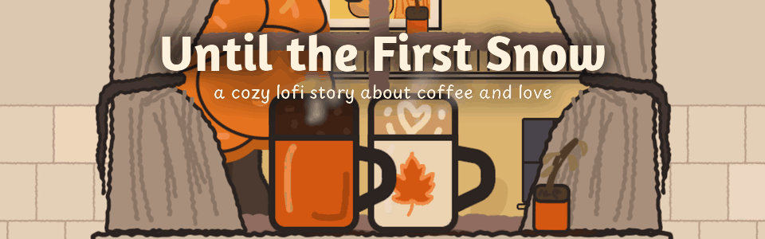
</p>

<h1 align="center">Until the First Snow</h1>

<p align="center"><i>a cozy lofi story about coffee and love</i></p>

<p align="center">
  Made in 72 hours for <a href="https://itch.io/jam/mini-jam-221-autumn">Mini Jam 221: Autumn</a> · limitation: <b>Staying Warm</b>
</p>

---

A tired office clerk makes himself a warm drink in a cold Budapest kitchen. Over one autumn he learns to enjoy small
rituals and falls in love with **Mira**, the neighbour whose window faces his across the courtyard.

Five mornings and evenings. Boil the kettle, grind the beans, pour slowly, steam the milk, and keep the warmth meter up.
A good drink warms you, a careless one leaves you shivering. Later there are two people to keep warm.

<p align="center">
  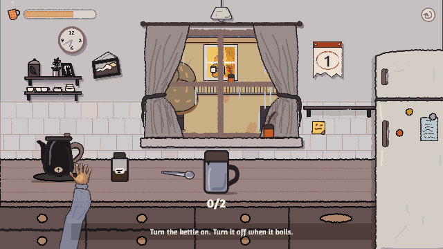
</p>

## How to play

- **Mouse only.** Click, hold and drag. Every step shows a short hint at the top of the screen.
- Keep the **warmth meter** above zero. Stop gauges in the green, fill to the line, and don't overdo the spices.
- Read Mira's notes on the fridge and keep an eye on her window across the courtyard.
- About 10 minutes from the first coffee to the first snow.

## The days

| | |
|---|---|
| 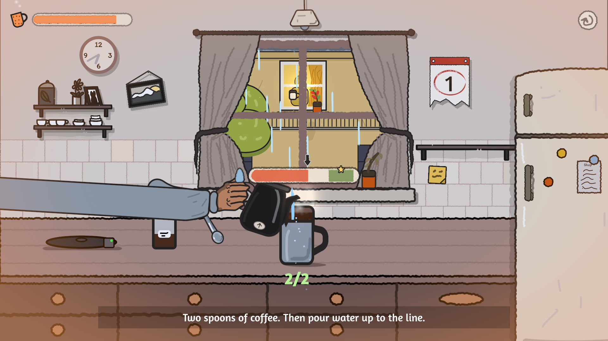 | 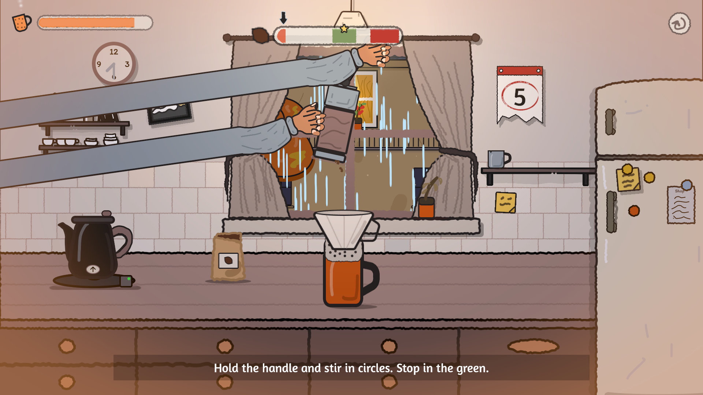 |
| **Day 1.** Grey morning, instant coffee. It tastes like Monday. | **Day 5.** Real beans, a hand grinder, heavy rain. |
| 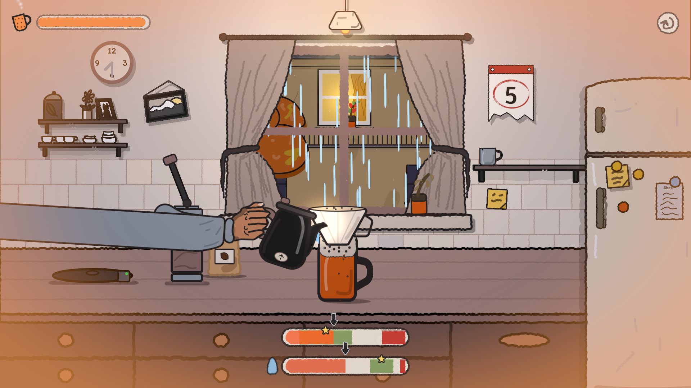 | 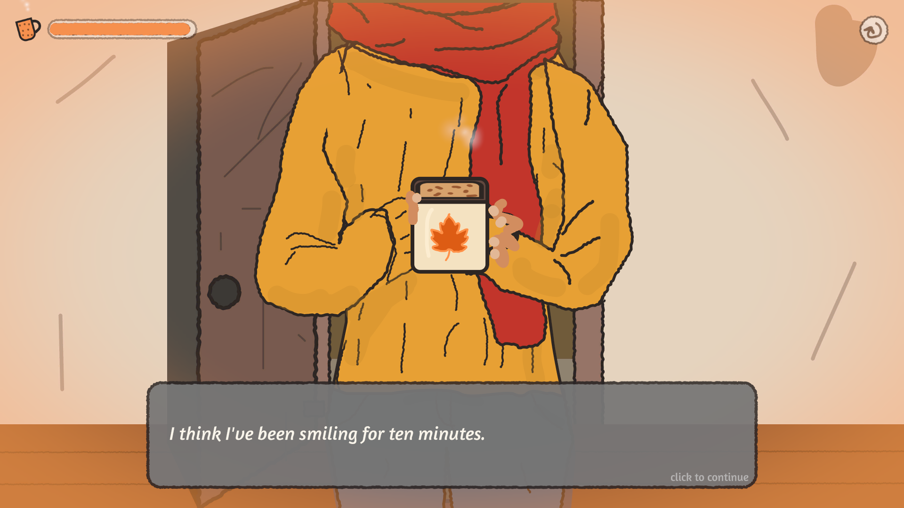 |
| **Day 5.** Pour slowly, in circles. | **Day 10.** A knock at the door. |
| 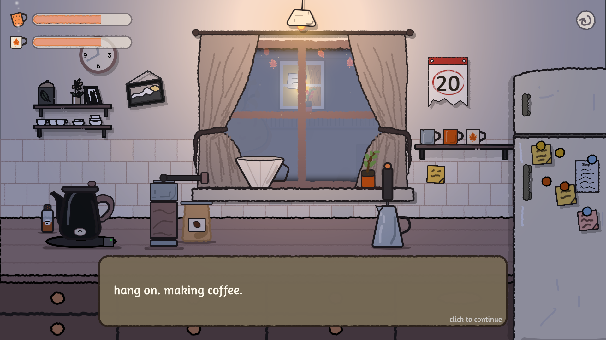 | 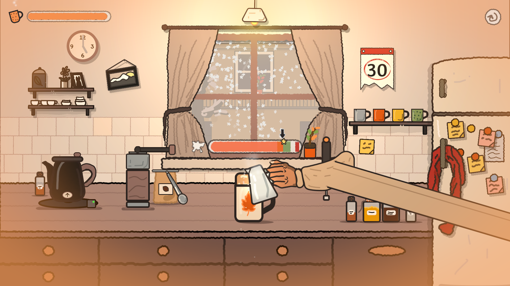 |
| **Day 20.** Her heating broke. Two cups tonight. | **Day 30.** First snow. You know her usual by now. |

<p align="center">
  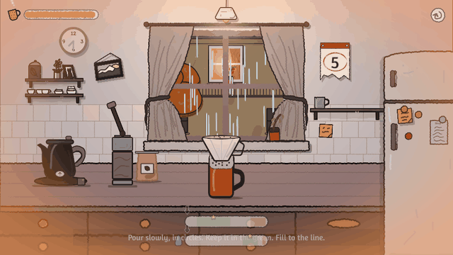
  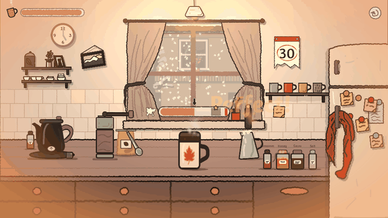
</p>

## Little things in the kitchen

| | | |
|---|---|---|
| 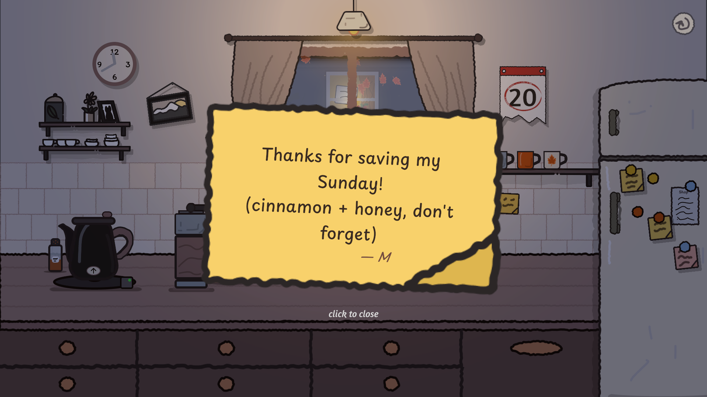 | 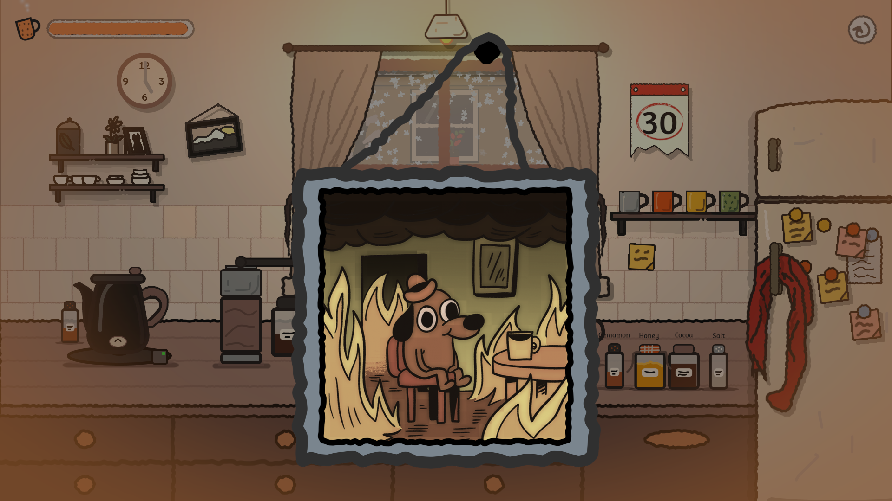 |  |
| Mira's notes collect on the fridge. | The picture on the wall opens up. | The calendar page tears off between days. |

Wipe the fog off the window on cold nights, earn a gold star for a perfect day, and stay after the credits.

<p align="center">
  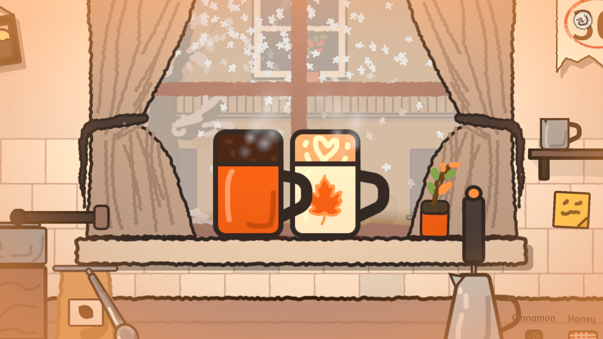
</p>

## Built with

- **Unity 6** (6000.3), URP 2D renderer with 2D lights per day, the Input System, TextMeshPro.
- WebGL first: a custom loading page and a 16:9 canvas that fits any window.
- Data-driven: each day is a `LevelDefinition` ScriptableObject (palette, weather, steps, story beats, warmth tuning).
- PlayMode playtests drive every day end to end with a virtual mouse (`Assets/_Game/Tests`).

```
Assets/_Game/
  Art/  Audio/  Data/  Prefabs/  Scenes/
  Scripts/  Core/  Kitchen/  Minigames/  Story/  UI/  Audio/  Editor/
  Tests/
```

Open the project in Unity 6000.3, load `Assets/_Game/Scenes/Boot.unity` and press Play.
To build for the web, use **File → Build Profiles → Web**.

## Credits

All art in the game is hand-drawn by the team. **No generative AI was used for art or audio.**

Music by **Purrple Cat** ([Just Relax](https://purrplecat.itch.io/just-relax), CC BY-SA 4.0).
Fonts: Amaranth and Playpen Sans (SIL OFL 1.1). Decor from ODDBLOT's Basic Coffee Shop pack.
The full list with licences is in [CREDITS.md](CREDITS.md).

<p align="center">
  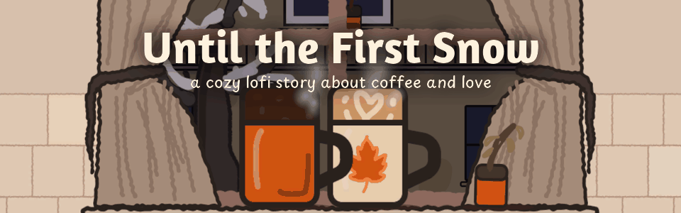
  <br><i>Thanks for playing. Stay warm.</i>
</p>
